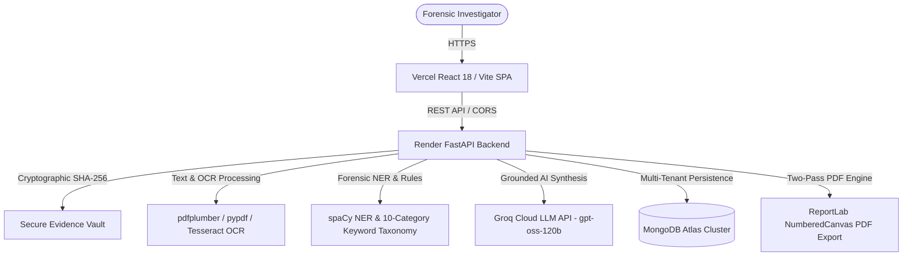

# AI Cyber Investigation Assistant — Production Walkthrough & Audit

**Date:** October 20, 2026  
**Repository:** `DhaksineshsaiG/AI-Cyber-Investigation-Assistant`  
**Deployment Stack:** Vercel (Frontend SPA) + Render (FastAPI Backend + Tesseract) + MongoDB Atlas (ReplicaSet) + Groq Cloud (`openai/gpt-oss-120b`)

---

## 1. System Architecture & Component Mapping

---

## 2. End-to-End Investigation Walkthrough

### Step 1: Case Creation & Vault Initialization
1. An investigator accesses the assistant workspace.
2. A unique case identifier (e.g. `CASE-2026-2032D`) is assigned and registered in MongoDB Atlas.
3. Investigator enters case title, lead investigator credentials, and initial incident background.

### Step 2: Multi-Format Evidence Ingestion & Cryptographic Hashing
1. Investigator drags and drops files into the Evidence Intake dropzone.
2. Supported formats:
   - Text logs: `.txt`, `.chat`, `.log`, `.eml`
   - Data files: `.csv`, `.json`
   - Office documents: `.docx`
   - Digital PDFs: `.pdf` (native text streams)
   - Scanned PDFs: `.pdf` (image-only pages extracted and OCR'd)
   - Images: `.png`, `.jpg`, `.jpeg`, `.tiff`, `.webp` (processed via Tesseract OCR)
3. For every uploaded file, the backend generates a standard SHA-256 digest before storing the artifact into the secure vault.
4. The UI displays the filename, file type, byte size, and truncated SHA-256 hash.

### Step 3: Forensic Pipeline Execution
When clicking **"Analyze Evidence"**, the backend executes:
1. **Content Extraction & OCR:** Runs format-specific parsers or Tesseract OCR with automatic `TESSDATA_PREFIX` detection.
2. **Named Entity Recognition (NER):** Detects Person names, Dates, Phone Numbers, Email Addresses, IP Addresses, and Organizations.
3. **Keyword Taxonomy Classification:** Classifies text across 10 security categories (`Unauthorized Access`, `Data Exfiltration`, `Deletion / Log Wiping`, `Credential Theft`, etc.) with severity weighting.
4. **Chronological Timeline Extraction:** Parses ISO and standard date-time stamps, tags risk categories, and sorts events chronologically.
5. **Cross-Evidence Correlation:** Discovers common entities and high-risk terms appearing across two or more separate files.
6. **Grounded Groq AI Synthesis:** Sends the structured factual dossier to Groq (`openai/gpt-oss-120b`) using strict JSON schema enforcement to produce:
   - Executive synthesis
   - Specific observations citing source filenames
   - Behavioral & technical risk patterns
   - Recommended follow-up leads for investigators
   - Grounding confidence note

### Step 4: Interactive Analysis Dashboard & AI Dossier Modal
1. The dashboard immediately updates with:
   - Evidence Summary stat tiles (`Documents Analyzed`, `Key Entities`, `Risk Signals`)
   - Suspicious Keywords card with severity pills and occurrence counts
   - Extracted Forensic Entities grouped by category with badge counters
   - AI Generated Insights card with executive summary and key finding cards
   - Cross-Evidence Correlation grid showing multi-source linkages
   - Chronological Timeline of events
2. Clicking **"Expand View"** or **Maximize** opens the fullscreen **AI Insights Modal** detailing executive synthesis, individual observation cards with SHA-256 copy, correlated linkages, and priority action items.

### Step 5: Formal PDF Report Generation
1. Clicking **"Export PDF Report"** streams a formal forensic investigation report generated via ReportLab:
   - Two-pass `NumberedCanvas` computing exact `Page X of Y` total page counts.
   - Running header with confidentiality caveats and running footer with cryptographic verification notes.
   - Case metadata table (Case ID, Investigator, Date, Evidence Count).
   - Executive AI synthesis and key findings cards.
   - Comprehensive Evidence Inventory table with split 32-character monospace SHA-256 hashes.
   - Chronological timeline table with timestamp, risk level, event detail, and source.
   - Cross-evidence correlation table with source breakdown.

---

## 3. Automated Test Suite Verification

| Test Suite File | Coverage | Execution Command | Result |
| :--- | :--- | :--- | :--- |
| `tests/test_groq_service.py` | Offline heuristic fallback & online JSON parsing | `uv run python -m tests.test_groq_service` | **PASSED (2/2)** |
| `tests/verify_atlas_direct.py` | Live MongoDB Atlas cluster topology & R/W operations | `uv run python -m tests.verify_atlas_direct` | **PASSED (5/5)** |
| `tests/test_ocr_and_extraction.py` | TXT, native PDF, image OCR, scanned PDF OCR, binary fallback | `uv run python -m tests.test_ocr_and_extraction` | **PASSED (6/6)** |
| `tests/test_forensic_services.py` | NER, 10-category keywords, timeline ordering, cross-correlation | `uv run python -m tests.test_forensic_services` | **PASSED (6/6)** |
| `tests/test_e2e_pipeline.py` | Complete 10-stage end-to-end pipeline & PDF generation | `uv run python -m tests.test_e2e_pipeline` | **PASSED (10/10)** |
| `tests/verify_prod_status.py` | Vercel frontend bundle & Render backend health check | `uv run python -m tests.verify_prod_status` | **PASSED (6/6)** |
| `tests/verify_prod_groq_e2e.py` | Live production Groq AI pipeline on Render | `uv run python -m tests.verify_prod_groq_e2e` | **PASSED (6/6)** |
| `tests/verify_deploy.py` | Production deployment assets, bundle integrity, CORS preflight | `uv run python -m tests.verify_deploy` | **PASSED (4/4)** |

---

## 4. Production Readiness & Security Summary

* **Secrets Management:** Zero API keys or database connection strings are tracked in git. All runtime credentials reside strictly in `.env` (server-side only).
* **Cross-Origin Resource Sharing (CORS):** Backend config allows requests from `https://ai-cyber-investigation-assistant.vercel.app` and localhost development ports.
* **Non-Interactive Deployability:** Backend packages cleanly into Docker container; frontend compiles cleanly via Vite with TypeScript strict checks enabled.
